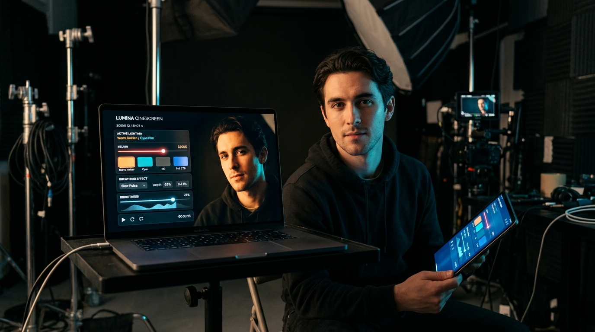
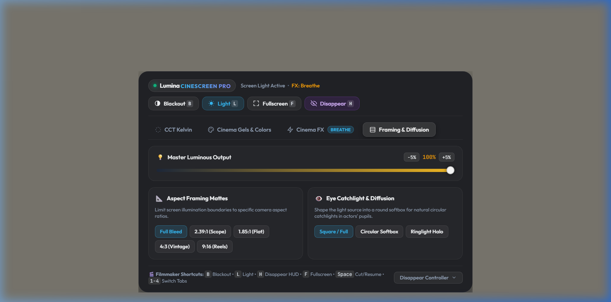
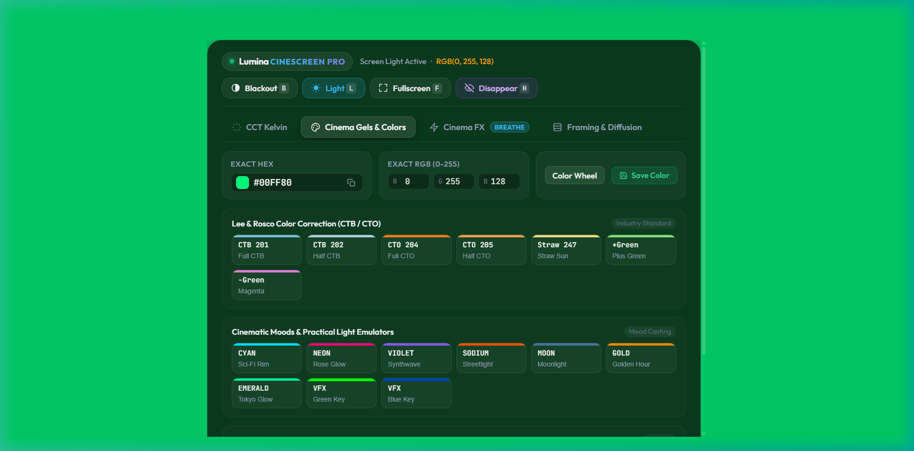
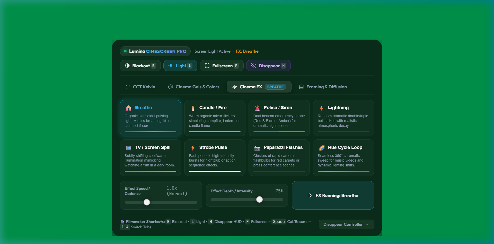

<div align="center">

# 🎬 Lumina CineScreen Pro
### *The Ultimate Pocket Cinema Screen Light & Lighting FX Studio for Filmmakers*

[](LICENSE)
[](https://developer.mozilla.org/en-US/docs/Web/JavaScript)
[-emerald.svg?style=for-the-badge)](https://github.com)
[](#)
[](#)

<br/>

<p align="center">
  
</p>

<p align="center">
  <strong>Transform any laptop, tablet, iPad, or mobile monitor into a high-CRI, zero-flicker cinema light, softbox, practical light source, and visual effects powerhouse.</strong>
</p>

[✨ Launch CineScreen](#-quick-start) • [💡 Why Filmmakers Need This](#-why-filmmakers-need-this) • [🫁 Cinema Effects](#-cinema-lighting-effects-engine-fx) • [🎨 Gels & Exact Palettes](#-lee--rosco-cinema-gels--precision-palettes) • [⌨️ Shortcuts](#%EF%B8%8F-filmmaker-hotkeys)

---

</div>

## 💡 Why Filmmakers Need This

On professional film sets, indie film productions, and mobile video shoots, lighting challenges occur constantly in tight spaces, car rigs, and tabletop setups:

```
┌─────────────────────────────────────────────────────────────────────────────┐
│                       ON-SET CINEMATOGRAPHY DILEMMA                         │
├─────────────────────────────────────────────────────────────────────────────┤
│ ❌ Heavy LED panels require c-stands, ballast boxes, and AC power cords.     │
│ ❌ Smartphones & tablets lack precise Kelvin white balance & Duv tint.      │
│ ❌ Built-in screen apps have distracting, bright UI buttons that show in     │
│    the camera's lens reflection or spill unnatural light onto the actor.    │
│ ❌ Pausing light between takes requires powering down the device, killing    │
│    the flow of the shot.                                                    │
└─────────────────────────────────────────────────────────────────────────────┘
                                      │
                                      ▼
┌─────────────────────────────────────────────────────────────────────────────┐
│                    LUMINA CINESCREEN PRO: THE SOLUTION                      │
├─────────────────────────────────────────────────────────────────────────────┤
│ ✅ Zero-Flicker Hardware-Accelerated High-Refresh Illumination              │
│ ✅ Organic Cinema FX: Sinusoidal Breathe, Candle, Police, Lightning, TV     │
│ ✅ Lee & Rosco Cinema Gel Emulations (CTB, CTO, Straw, Cyan, Neon)          │
│ ✅ Precise Kelvin (1800K - 10000K) + Green/Magenta Duv Shift Balance        │
│ ✅ Exact HEX / RGB / HSL Bi-Directional Input Synchronization               │
│ ✅ Stealth Disappear Controller: Slides completely away during the take     │
│    without ever getting lost (unobtrusive revival pill + instant hotkey)    │
│ ✅ Instant OLED Pitch Blackout: Cut lighting to true zero with 1 tap (B)    │
│ ✅ Aspect Mattes (2.39:1 Scope, 1.85:1, 4:3) & Pupil Catchlight Softboxes  │
└─────────────────────────────────────────────────────────────────────────────┘
```

---

## 📸 Visual Tour & Core Systems

### 1. 🌡️ Precision CCT Kelvin & Duv Tint Engine

<p align="center">
  
</p>

* **Continuous Kelvin Sweep:** Seamlessly adjust white balance from **1,800K (Candlelight Flame)** up to **10,000K (Deep Blue Shade)**.
* **Plus / Minus Green Duv Balance:** Compensate for camera sensor tint or match overhead industrial fluorescent fixtures.
* **1-Tap Cinema Presets:** Direct quick buttons for `1850K Candle`, `2400K Golden Hour`, `3200K Tungsten Halogen`, `4300K Fluorescent`, `5600K Daylight Cine`, `6500K Cloudy Sky`, and `8000K Deep Shade`.

---

### 2. 🎨 Lee & Rosco Cinema Gels & Exact Color Inputs

<p align="center">
  
</p>

Filmmakers and DPs cannot guess colors on set. Lumina CineScreen Pro provides:
* **Exact HEX Input:** Type or paste any 6-digit hex value (`#FF5500`) with live validation and one-click copy.
* **Exact RGB Values:** Dedicated numeric fields for Red, Green, and Blue (`0` to `255`) with instant bi-directional calculation.
* **Color Correction Gels:** Pre-calibrated Lee filters including `Lee 201 Full CTB`, `Lee 202 Half CTB`, `Lee 204 Full CTO`, `Lee 205 Half CTO`, `Lee 247 Filter Straw`, and `Plus/Minus Green`.
* **Atmospheric Mood Gels:** `Blade Runner Cyan`, `Miami Neon Rose`, `Cyberpunk Violet`, `Sodium Streetlamp`, `Moonlight 4100K`, and `Tokyo Emerald`.
* **VFX Screen Replacement:** Pixel-pure `Chroma Key Green (0,255,0)` and `Chroma Key Blue (0,71,187)` for phone/tablet screen green screen replacements in post-production.
* **Custom Palette Bank:** Save any dialed-in color with a custom name (`+ Save Color`), persisted automatically in local storage.

---

### 3. 🫁 Cinema Lighting Effects Engine (FX)

<p align="center">
  
</p>

Bring scenes to life with organic, 60fps hardware-accelerated practical light motion:

| Effect | Visual Characteristics | Cinematography Use Case |
| :--- | :--- | :--- |
| **🫁 Breathe** | Smooth sinusoidal breathing pulsation with natural curve | Living creature glow, sci-fi reactor core, meditating subject, dream states |
| **🕯️ Candle / Fire** | Warm organic micro-flickers with realistic perlin-like wind jitter | Campfire scenes, romantic candlelit dinners, medieval tavern torches |
| **🚨 Police / Siren** | Double-burst alternating Red & Blue emergency beacons | Nighttime exterior police pulls, crime scenes, urban thriller lighting |
| **⚡ Lightning** | Atmospheric pauses followed by violent randomized double/triple strikes | Thunderstorms, gothic horror, window flash simulation |
| **📺 TV / Screen Spill** | Shifting cool blue and warm movie light fluctuations | Actors watching movies in dark bedrooms, living room nighttime shots |
| **⚡ Strobe Pulse** | Precision frequency-controlled periodic bursts (2.4 Hz - 36 Hz) | Nightclubs, music videos, intense action disorientation |
| **📸 Paparazzi** | Clustered rapid camera flashes with authentic decay | Red carpet scenes, press conferences, crime scene reporters |
| **🌈 Hue Cycle Loop** | Seamless 360° chromatic color wheel sweep | Modern music videos, synthwave aesthetics, psychedelic transitions |

> **Pro FX Sliders:** Fine-tune **Speed / Cadence** (`0.2x` to `3.0x`) and **Depth / Intensity** (`20%` to `100%`) live during the take.

---

### 4. 👻 Stealth "Disappear" Controller (Never Gets Lost!)

<p align="center">
  
</p>

A common failure of normal lighting apps is that control buttons remain visible on screen, ruining the shot or creating distracting reflections in the actor's glasses or eyes.

* **1-Click Disappearance:** Click **Disappear Controller** (or press <kbd>H</kbd>). The glass HUD slides down and vanishes completely, leaving a 100% clean, pure edge-to-edge illumination canvas.
* **Never Lost:** Unlike rudimentary hide tools, Lumina provides:
  1. A low-glow, semi-translucent floating pill `Show Controls [H]` in the bottom-right corner (dimmed to 40% so it spills negligible light onto the scene, but illuminates on cursor hover).
  2. Clicking anywhere on the canvas immediately reveals the HUD.
  3. Pressing <kbd>H</kbd>, <kbd>Space</kbd>, or <kbd>Esc</kbd> instantly returns the controls.
  4. Auto-hides mouse cursor after 4.5 seconds of inactivity so no arrow pointer ruins the shot.

---

### 5. 📐 Framing Mattes & Eye Catchlight Softbox

* **Anamorphic & Academy Mattes:** Limit illumination to real aspect ratio borders: `2.39:1 (Scope)`, `1.85:1 (Flat)`, `4:3 (Vintage Academy)`, or `9:16 (Vertical Reels)`.
* **Pupil Catchlight Modes:** Shape the rectangular monitor into a circular softbox or ring light halo so the reflection in the actor's eye is a round, natural reflection instead of a boxy monitor shape.

---

## ⌨️ Filmmaker Hotkeys

Work fast on set with tactile keyboard shortcuts:

| Shortcut | Action | Description |
| :---: | :--- | :--- |
| <kbd>Space</kbd> | **Toggle Blackout / Light** | Instant silence/cut of light between takes |
| <kbd>B</kbd> | **Pitch Blackout Mode** | True OLED #000000 blackout |
| <kbd>L</kbd> | **Screen Light Mode** | Resume calibrated screen lighting |
| <kbd>H</kbd> | **Disappear / Restore HUD** | Toggle stealth controller for clean scene lighting |
| <kbd>F</kbd> | **Toggle Fullscreen** | Expand edge-to-edge without browser chrome |
| <kbd>1</kbd> | **CCT Kelvin Tab** | Switch to Color Temperature & Tint sliders |
| <kbd>2</kbd> | **Cinema Gels Tab** | Switch to Gel Library & Precision Hex/RGB |
| <kbd>3</kbd> | **Cinema FX Tab** | Switch to Breathe, Candle, Police, Lightning FX |
| <kbd>4</kbd> | **Master / Framing Tab** | Switch to Brightness, Mattes & Catchlight shapes |
| <kbd>Esc</kbd> | **Restore Controls** | Emergency summon of the control HUD |

---

## 🚀 Quick Start

Lumina CineScreen Pro is engineered with **Zero External Dependencies** and runs on any modern browser (Chrome, Safari, Firefox, Edge, iPadOS Safari, Android Chrome).

### Run Locally:
```bash
# Clone the repository
git clone https://github.com/Demmonics/lumina-cinescreen.git

# Enter directory
cd lumina-cinescreen

# Open directly in any browser (no build step or npm install needed!)
open index.html   # On macOS
start index.html  # On Windows
```

---

## 🛠️ Technical Specifications

* **Rendering Engine:** GPU-accelerated CSS Variables + WebGL/Canvas timing loop via `requestAnimationFrame`.
* **Color Accuracy:** Standard D65 white point Kelvin conversion algorithm with Duv Green-Magenta offset.
* **Display Support:** Calibrated for 8-bit and 10-bit Rec.709, sRGB, and Display P3 wide gamut panels.
* **Storage:** LocalStorage persistence for user custom palettes, last used Kelvins, and brightness levels.

---

## 📄 License

Distributed under the **MIT License**. See `LICENSE` for more information.

<div align="center">
  <sub>Built for Directors of Photography, Gaffers, Indie Creators, and Cinema Lovers everywhere. 🎥</sub>
</div>
